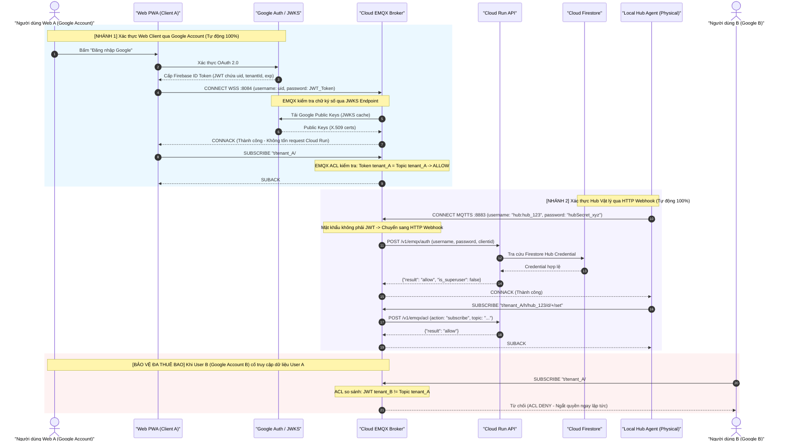
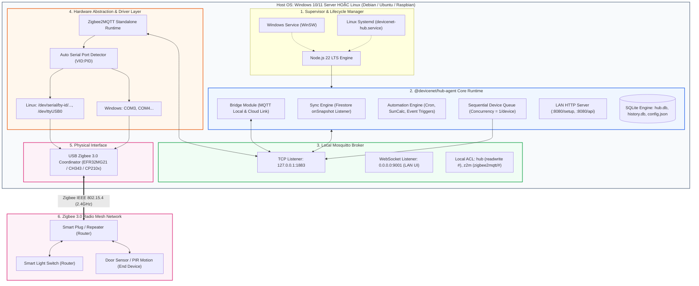
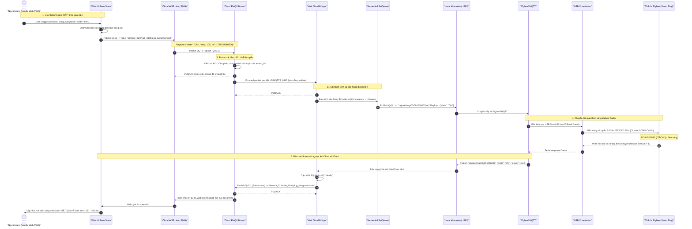

# DeviceNet: High-Level System Architecture & End-to-End Flows

Tài liệu này mô tả chi tiết kiến trúc hệ thống mức cao (**High-Level System Architecture**) của **DeviceNet**, bao gồm thiết kế đa người dùng (**Multi-tenancy**), cơ chế xác thực kép (**Dual Authentication & Authorization**) trên Cloud EMQX Broker, kiến trúc khối của **Local Hub** (Windows & Linux), và toàn cảnh đường đi của một lệnh điều khiển từ Client tới thiết bị vật lý (**End-to-End Command Flow**).

---

## 1. Sơ đồ Kiến trúc Tổng quan (System Overview Block Diagram)

```mermaid
flowchart TB
    %% Multi-tenant Clients %%
    subgraph MultiTenantClients ["1. Multi-Tenant Client Layer"]
        subgraph TenantA ["Tenant A (User A - Google Account A)"]
            ClientA1["Web PWA A1 (Chrome/Desktop)"]
            ClientA2["Web PWA A2 (Mobile iOS/Android)"]
        end
        subgraph TenantB ["Tenant B (User B - Google Account B)"]
            ClientB1["Web PWA B1 (Desktop)"]
        end
    end

    %% Cloud Infrastructure %%
    subgraph CloudGCP ["2. Cloud Platform (Google Cloud Platform - 0 Cost Always Free)"]
        subgraph CloudIdentity ["Identity & Auth Provider"]
            GoogleOAuth["Google Identity / OAuth 2.0"]
            FirebaseAuth["Firebase Authentication"]
            GoogleJWKS["Google JWKS Public Keys Endpoint"]
        end

        subgraph ServerlessAPI ["Serverless Cloud Run API (Fastify 5)"]
            ApiServer["Cloud Run: devicenet-api"]
            EmqxAuthRoute["POST /v1/emqx/auth (Hub Auth)"]
            EmqxAclRoute["POST /v1/emqx/acl (Hub ACL)"]
            EmqxWebhookRoute["POST /v1/emqx/webhook (Mirror)"]
        end

        subgraph CloudData ["Cloud Storage"]
            FirestoreDB[("Cloud Firestore: tenants, hubs, rules, sites")]
            SecretMgr["Secret Manager: devicenet-secrets"]
        end

        subgraph CloudBroker ["Compute Engine VM (e2-micro / us-central1)"]
            CaddyProxy["Caddy 2.8 Kick Proxy (HTTPS :443)"]
            EMQXBroker["EMQX 5.8 OSS Broker (Native Systemd)"]
            subgraph EmqxEngines ["EMQX Core Engines"]
                JwtAuth["JWT Authenticator (Google JWKS)"]
                HttpAuth["HTTP Password Authenticator (API Webhook)"]
                AclEngine["Topic ACL Engine (Tenant Isolation)"]
                RuleEngine["Rule Engine (Hub Status Webhook)"]
            end
        end
    end

    %% Edge / Local Hub Layer %%
    subgraph LocalHubLayer ["3. Edge / Local Hub Layer (Windows & Linux)"]
        subgraph LocalHubA ["Local Hub 01 (Home of Tenant A)"]
            HubAgentA["Hub Agent Core (Node.js 22 Runtime)"]
            LocalDbA[("Local SQLite: hub.db, history")]
            LocalMosquittoA["Local Mosquitto (:1883 & :9001)"]
            Z2MA["Zigbee2MQTT Service"]
            DongleA["USB Zigbee Dongle (Sonoff / CH9102)"]
        end

        subgraph LocalHubB ["Local Hub 02 (Home of Tenant B)"]
            HubAgentB["Hub Agent Core (Node.js 22 Runtime)"]
            DongleB["USB Zigbee Dongle"]
        end
    end

    %% Physical Smart Devices %%
    subgraph PhysicalDevices ["4. Physical Zigbee Devices (Mesh Network)"]
        PlugA["Smart Plug Relay (Living Room)"]
        SensorA["Temperature / Humidity Sensor"]
        SwitchB["Smart Wall Switch"]
    end

    %% Connections %%
    ClientA1 -- "1. Google Login" --> FirebaseAuth
    ClientB1 -- "1. Google Login" --> FirebaseAuth
    FirebaseAuth -. "Verify OAuth" .-> GoogleOAuth

    ClientA1 == "2. WSS :8084 (Firebase JWT)" ==> EMQXBroker
    ClientB1 == "2. WSS :8084 (Firebase JWT)" ==> EMQXBroker
    EMQXBroker -. "JWKS Verify (Zero API calls)" .-> GoogleJWKS

    HubAgentA == "MQTTS :8883 (hub:id + secret)" ==> EMQXBroker
    HubAgentB == "MQTTS :8883 (hub:id + secret)" ==> EMQXBroker

    HttpAuth --> EmqxAuthRoute
    AclEngine --> EmqxAclRoute
    RuleEngine --> EmqxWebhookRoute

    EmqxAuthRoute --> FirestoreDB
    EmqxAclRoute --> FirestoreDB
    EmqxWebhookRoute --> FirestoreDB
    ApiServer --> FirestoreDB

    HubAgentA <--> LocalMosquittoA
    LocalMosquittoA <--> Z2MA
    Z2MA <--> DongleA
    DongleA <--> PlugA
    DongleA <--> SensorA
    DongleB <--> SwitchB

    classDef clientClass fill:#E0F2FE,stroke:#0284C7,stroke-width:2px,color:#0F172A;
    classDef cloudClass fill:#FEF3C7,stroke:#D97706,stroke-width:2px,color:#0F172A;
    classDef brokerClass fill:#DCFCE7,stroke:#16A34A,stroke-width:2px,color:#0F172A;
    classDef hubClass fill:#F3E8FF,stroke:#9333EA,stroke-width:2px,color:#0F172A;
    classDef deviceClass fill:#FFE4E6,stroke:#E11D48,stroke-width:2px,color:#0F172A;

    class ClientA1,ClientA2,ClientB1 clientClass;
    class ApiServer,FirestoreDB,SecretMgr,GoogleOAuth,FirebaseAuth,GoogleJWKS cloudClass;
    class CaddyProxy,EMQXBroker,JwtAuth,HttpAuth,AclEngine,RuleEngine brokerClass;
    class HubAgentA,HubAgentB,LocalDbA,LocalMosquittoA,Z2MA,DongleA,DongleB hubClass;
    class PlugA,SensorA,SwitchB deviceClass;
```

---

## 2. Luồng Xác thực & Phân quyền (Authentication & Authorization Flow)

Hệ thống xử lý xác thực qua hai nhánh độc lập nhưng hội tụ tại **EMQX Broker**:

---

## 3. Kiến trúc Chi tiết Khối Local Hub (Windows & Linux)

Local Hub được thiết kế để chạy liên tục 24/7 trên cả **Windows** và **Linux** (Raspberry Pi, Mini PC) với cấu trúc dịch vụ phân tầng:

---

## 4. Block View: Toàn cảnh Một Lệnh Điều Khiển (End-to-End Command Flow)

Dưới đây là hành trình từng mili-giây của một lệnh toggle bật/tắt công tắc từ lúc người dùng chạm tay vào màn hình Web PWA cho đến khi rơ-le vật lý đóng lại và trạng thái phản hồi về điện thoại:

---

## 5. Tóm tắt các Quy tắc Thiết kế Bất biến (Architectural Invariants)

| Nguyên tắc | Chi tiết hiện thực | Mục tiêu đạt được |
| :--- | :--- | :--- |
| **Không hop thừa** | Lệnh đi trực tiếp: `Web -> EMQX -> Hub -> Device`. Không bao giờ gọi qua REST Cloud Run để bật tắt đèn. | Độ trễ dưới **400 ms** (so với 1.5 - 3s nếu đi qua HTTP webhook). |
| **Bền vững không mạng** | Toàn bộ Rules và Automations lưu trữ trong SQLite cục bộ của Hub. | Khi mất cáp quang / mất Cloud, Hub vẫn tự chạy kịch bản cảm biến bật đèn bình thường. |
| **Cô lập Đa thuê bao** | Topic MQTT bắt buộc có tiền tố `t/<tenantId>/`. EMQX tự động chặn đứng nếu client cố gắng đọc/ghi vào tenant khác. | Đảm bảo tính riêng tư tuyệt đối giữa các hộ gia đình / tài khoản Google khác nhau. |
| **Chi phí 0đ vĩnh viễn** | VM `e2-micro`, Cloud Run scale-to-zero, Firestore Native, 1 Secret JSON duy nhất. | Toàn bộ hạ tầng hoạt động trong gói **Google Cloud Always Free**. |
